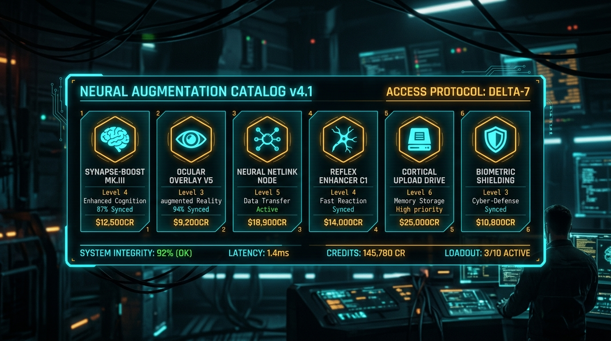
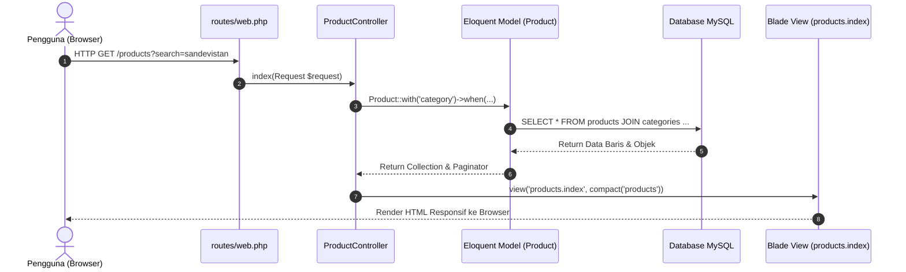
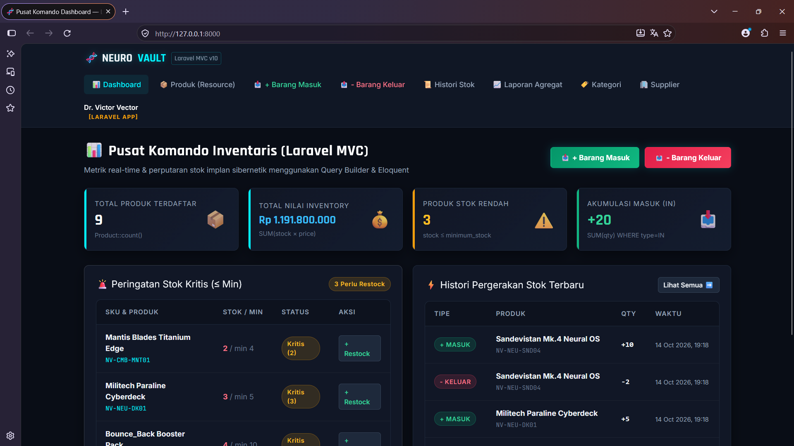
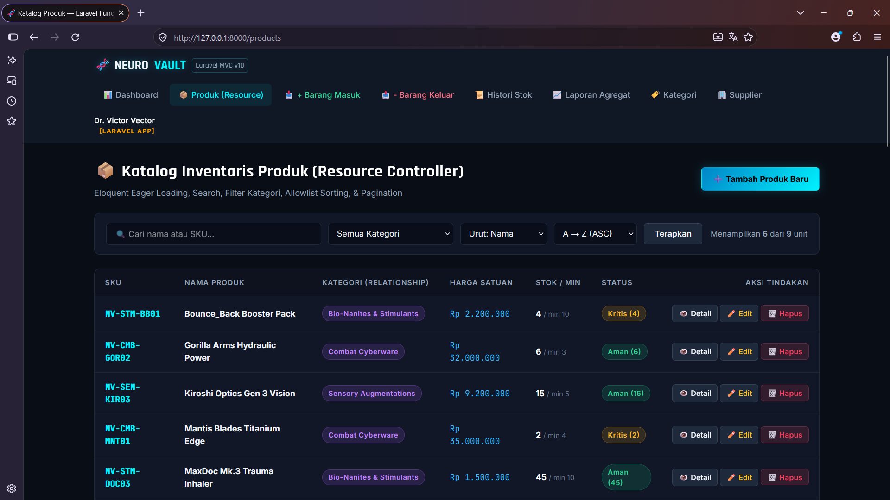
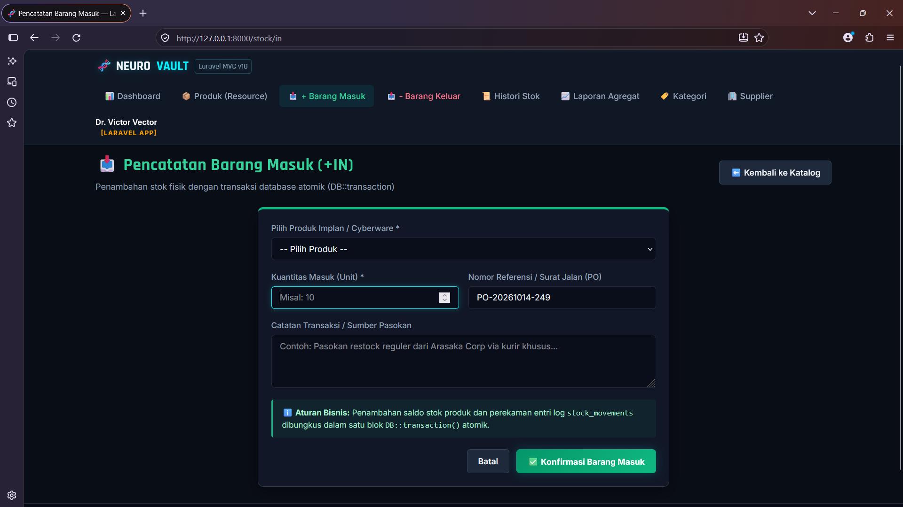
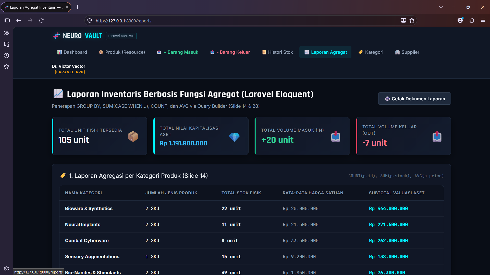

<div align="center">

# 🧬 NeuroVault IMS — Laravel Application
### Mengubah Inventory Management System P4 Menjadi Arsitektur Laravel MVC

[](https://laravel.com/)
[](https://www.php.net/)
[](https://www.mysql.com/)
[-amber?style=for-the-badge)](https://github.com/)



*Refactoring dan migrasi menyeluruh dari PHP Native (P4) menuju arsitektur modern Laravel MVC (P5) dengan mempertahankan seluruh aturan bisnis (business logic).*

</div>

---

## 📌 Posisi & Tujuan Pertemuan 5 (Slide 02)

* **Pertemuan 4** menghasilkan *Inventory Management System* berbasis PHP Native & PDO manual.
* **Pertemuan 5** tidak membuat masalah bisnis dari nol, melainkan **memindahkan dan merapikan sistem P4 ke arsitektur Laravel Framework**.
* **Konsep database dan business logic tetap dipertahankan**:
  $$\text{P4 = Memahami Masalah Bisnis} \quad\longrightarrow\quad \text{P5 = Mengimplementasikan dengan Arsitektur Laravel}$$

---

## 🔄 Target Migrasi (Slide 35)

| Komponen P4 (PHP Native) | Komponen P5 (Laravel MVC) | Keterangan Implementasi di Proyek Ini |
| :--- | :--- | :--- |
| `database/schema.sql` | `database/migrations/` | Version control skema tabel (`categories`, `products`, `suppliers`, `stock_movements`). |
| Form PHP manual | Blade form + validation | Form dengan `@csrf`, directive `@error`, dan validasi `$request->validate()`. |
| Query PDO manual | Eloquent ORM & Query Builder | Sintaks ekspresif, relationship antar-model, dan eager loading `with()`. |
| File CRUD terpisah | Resource Controller | `ProductController` mengelola 7 aksi RESTful (`index`, `create`, `store`, `show`, `edit`, `update`, `destroy`). |
| Template manual (`include`) | Blade Layout & Component | `@extends('layouts.app')`, `@section`, `@yield`, dan Blade component `<x-alert>`. |
| Business Logic Stok | Database Transaction Atomik | `DB::transaction()` dan penguncian baris `Product::lockForUpdate()` saat barang keluar. |

---

## 🏛️ Arsitektur Alur Request ke Response (Slide 10 & 47)

Setiap aksi pengguna diproses secara runtut memisahkan tanggung jawab (Separation of Concerns):



---

## 🛠️ Relasi Eloquent Antar-Model (Slide 33 & 34)

* **Category & Product (One-to-Many)**:
  * `Category` hasMany `Product` (`$this->hasMany(Product::class)`)
  * `Product` belongsTo `Category` (`$this->belongsTo(Category::class)`)
* **Product & Supplier (Many-to-Many)**:
  * `Product` belongsToMany `Supplier` via pivot table `product_suppliers` dengan kolom tambahan `supplier_price`.
  * `Supplier` belongsToMany `Product`.
* **Product & StockMovement (One-to-Many)**:
  * `Product` hasMany `StockMovement` (jejak audit pergerakan keluar-masuk barang).

---

## 📋 Daftar Rute Web Terdaftar (`php artisan route:list`)

| HTTP Method | URI Endpoint | Nama Route | Action Controller | Kegunaan |
| :--- | :--- | :--- | :--- | :--- |
| `GET` | `/` | `dashboard` | `DashboardController@index` | Pusat ringkasan metrik inventaris |
| `GET` | `/products` | `products.index` | `ProductController@index` | Katalog produk (Search, Filter, Sort, Pagination) |
| `GET` | `/products/create` | `products.create` | `ProductController@create` | Form tambah produk baru |
| `POST` | `/products` | `products.store` | `ProductController@store` | Simpan data produk baru (Validasi) |
| `GET` | `/products/{product}` | `products.show` | `ProductController@show` | Rincian spesifikasi & mutasi produk |
| `GET` | `/products/{product}/edit`| `products.edit` | `ProductController@edit` | Form edit produk |
| `PUT` | `/products/{product}` | `products.update` | `ProductController@update` | Update data produk |
| `DELETE` | `/products/{product}` | `products.destroy` | `ProductController@destroy`| Hapus produk (Integritas referensial RESTRICT) |
| `GET` | `/stock/in` | `stock.in` | `StockController@inCreate` | Form catat barang masuk (+IN) |
| `POST` | `/stock/in` | `stock.in.store` | `StockController@inStore` | Eksekusi transaksi atomik barang masuk |
| `GET` | `/stock/out` | `stock.out` | `StockController@outCreate` | Form catat barang keluar (-OUT) |
| `POST` | `/stock/out` | `stock.out.store` | `StockController@outStore` | Eksekusi barang keluar (Pencegahan stok negatif) |
| `GET` | `/stock/history` | `stock.history` | `StockController@history` | Log buku besar mutasi stok lengkap |
| `GET` | `/reports` | `reports.index` | `ReportController@index` | Laporan agregasi SQL (Slide 14 & 28) |
| `GET` | `/categories` | `categories.index` | `CategoryController@index` | Master data kategori |
| `GET` | `/suppliers` | `suppliers.index` | `SupplierController@index` | Master data vendor supplier |

---

## 🧪 Demonstrasi Alur Lengkap (Slide 48)

> **Skenario: Membuka Form &rarr; Validasi &rarr; Simpan &rarr; Redirect &rarr; Tampilkan Data**

1. **Membuka Form**: Pengguna mengakses `/products/create`. `ProductController@create` menyajikan view Blade form dengan proteksi token `@csrf`.
2. **Validasi Request**: Pengguna mengisi formulir dan menekan submit (POST `/products`). `ProductController@store` memvalidasi input:
   * Kode SKU wajib unik (`unique:products,sku`).
   * Harga dan stok tidak boleh bernilai negatif (`min:0`).
   * Jika tidak valid, Laravel me-redirect kembali ke form dengan pesan error spesifik via directive `@error('field')`.
3. **Simpan ke Database (Eloquent & ACID Transaction)**: Data yang lolos validasi disimpan menggunakan `Product::create($validated)`. Jika ada relasi vendor atau stok awal, transaksi dibungkus dalam `DB::transaction()`.
4. **Redirect dengan Flash Message**: Sistem melakukan pengalihan:
   ```php
   return redirect()->route('products.index')
       ->with('success', 'Produk berhasil disimpan.');
   ```
5. **Tampilkan Data**: Pengguna diarahkan ke halaman `/products` yang menampilkan produk baru beserta notifikasi sukses menggunakan Blade component `<x-alert type="success">`.

---

## 📸 Dokumentasi & Hasil Pengujian Fitur

| 1. Pusat Komando Dashboard | 2. Katalog Produk & Filter |
| :---: | :---: |
|  |  |

| 3. Form Tambah Produk (Validasi CSRF) | 4. Laporan Agregasi SQL (Slide 14 & 28) |
| :---: | :---: |
|  |  |

---

## ✅ Acceptance Criteria Checklist (Slide 41 & 46)

- [x] **Aplikasi dapat dijalankan** dari project Laravel baru (`php artisan serve`).
- [x] **Konfigurasi `.env`** terhubung dengan benar ke database MySQL `inventory_db`.
- [x] **Daftar route** lengkap terdaftar pada `php artisan route:list`.
- [x] **Migration** dapat dijalankan dari database kosong (`php artisan migrate:fresh`).
- [x] **Seeder** menghasilkan data awal pengujian yang realistis (`--seed`).
- [x] **Model** memiliki relationship yang benar (`Category hasMany Product`, `Product belongsToMany Supplier`).
- [x] **Resource Controller** menangani seluruh siklus CRUD produk (`ProductController`).
- [x] **Blade** menerapkan layout terpadu (`@extends`) dan escaping otomatis (`{{ }}`).
- [x] **Form** dilengkapi proteksi `@csrf` dan pesan error validasi (`@error`).
- [x] **Search & Pagination** mempertahankan query string URL (`withQueryString()`).
- [x] **Business Rule P4 tetap berjalan**: stok keluar dilarang melebihi stok yang ada (`lockForUpdate`), stok tidak pernah negatif, dan produk berhistori dilarang dihapus (`restrictOnDelete`).

---

## 🚀 Panduan Instalasi & Menjalankan Aplikasi

### 1. Prasyarat Sistem
* PHP 8.1 atau lebih baru (dengan ekstensi `pdo_mysql`, `mbstring`, `openssl`).
* MySQL Server (bisa menggunakan modul MySQL pada XAMPP Control Panel).

### 2. Langkah Menjalankan:
1. Pastikan modul **MySQL** di XAMPP Control Panel sudah dalam status **Start**.
2. Buka terminal di folder `Mini_project4`:
   ```powershell
   # 1. Generate Application Key (Jika belum ada)
   php artisan key:generate

   # 2. Jalankan Migrasi Tabel & Data Seeder
   php artisan migrate:fresh --seed

   # 3. Jalankan Local Server
   php artisan serve
   ```
3. Atau cukup **klik dua kali (double click)** file jalan pintas:
   👉 **`run_laravel.bat`**
4. Akses aplikasi di browser Anda melalui alamat:
   👉 **`http://127.0.0.1:8000`**

---

## 👨‍💻 Penulis & Pengembang

* **Pengembang**: Rafif ([@JavaFizd](https://github.com/JavaFizd))
* **Mata Kuliah / Modul**: Pemrograman Web — Pertemuan 5: Laravel Fundamental
* **Tahun**: 2026
